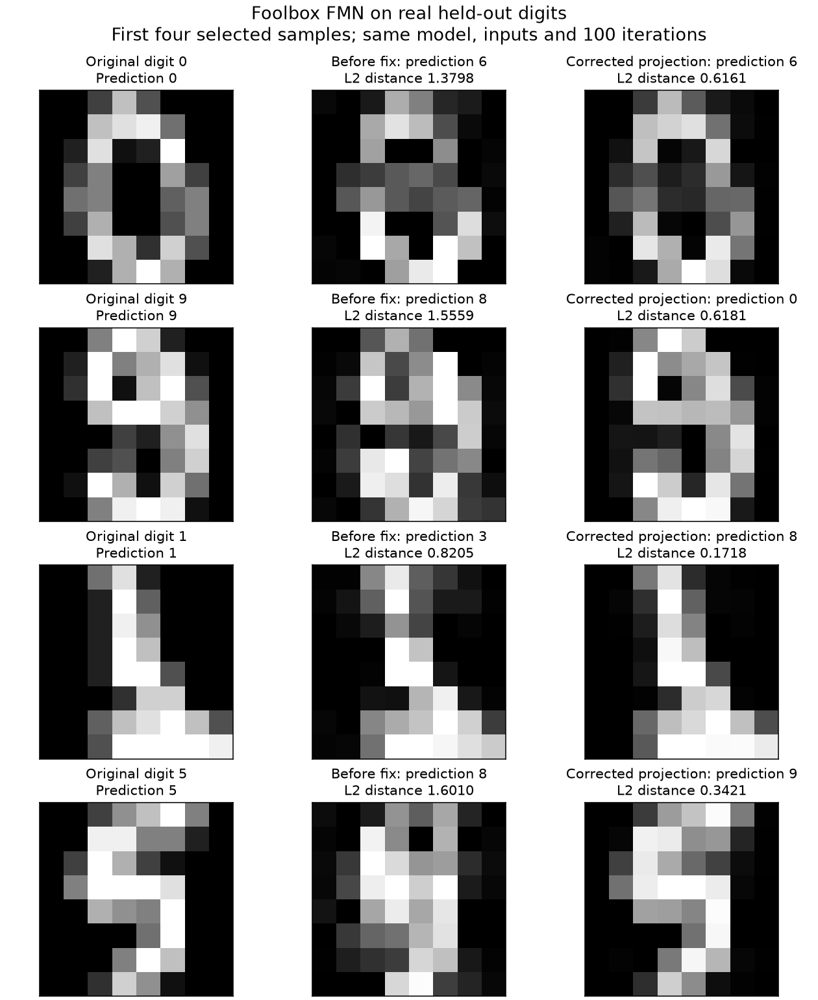

# Foolbox FMN L2 projection — submitted upstream

Implemented in [your fork](https://github.com/daniyyell-dev/foolbox/tree/fix/fmn-l2-projection), commit `5691f3811605a7b70c92f9a613b86b5fc8a6270e`, against upstream `2513a9a8675d7017e5266d3b0ed89124cb436ec5`. Submitted on 27 October 2026: [issue #741](https://github.com/bethgelab/foolbox/issues/741), [PR #742](https://github.com/bethgelab/foolbox/pull/742) and [linking issue comment](https://github.com/bethgelab/foolbox/issues/741#issuecomment-6450387999). The PR is open and mergeable. Upstream Docs and Tests workflows require maintainer approval (`action_required`); they have not run. Maintainer review and merge are pending. [Verified submission record](submission/status.json), [posted PR description](submission/pr-body.md), [workflow snapshot](submission/workflows-verified.json).

## The bug and fix

`L2FMNAttack.project` computes `norms / norms`, so its scale factor is always one. It also measures the absolute candidate rather than the displacement from `x0`. The correction uses the L2 norm of `x - x0` and the scale `min(1, epsilon / norm)`.

| Example | Before | After |
|---|---|---|
| Centre `[0, 0]`, candidate `[3, 4]`, radius `0.5` | Returns `[3, 4]`, distance **5.0** | Returns `[0.3, 0.4]`, distance **0.5** |
| A candidate inside its radius | Preserved | Preserved |
| Zero radius | Candidate can remain outside the ball | Returns the centre |

The fix is two production-line changes. Tests cover translated centres, per-sample radii, scalar radii, vector/image shapes, interior points, zero perturbations, zero radii, finite values and idempotence. All three new cases fail before the correction and pass afterwards.

## Validation

- NumPy/Python 3.13.13: **40 passed, 162 skipped** across FMN, distances, criteria and devutils. [Log](after-numpy.log).
- PyTorch 2.13.0 on CPU: **23 passed, 20 skipped, 90 deselected** for FMN projection and existing simple-model targeted/untargeted cases. [Log](after-pytorch.log).
- Python 3.10.20 / NumPy 1.26.4: **3 new projection cases passed**. [Log](after-python310.log).
- Pinned Black 22.3.0, flake8 6.1.0 and targeted mypy 1.6.1 passed; whitespace checks passed. TensorFlow/JAX, GPU and the full upstream suite were not run locally.

## Real handwritten digits

The experiment trains a 64→32→10 tanh MLP on 1,347 digits, evaluates 450 held-out images, and selects the first 100 correctly classified held-out samples from a seeded stratified split (seed 42). Clean accuracy is **431/450**. Both versions use the identical model, inputs, labels and 100-iteration settings; the baseline restores only the upstream projection method. The script requires running from the checked-out Foolbox repository and verifies its import path.

| Version/mode | Successful attacks | Median norm among successful samples |
|---|---:|---:|
| before_untargeted | 100/100 | 0.937502 |
| before_targeted | 100/100 | 1.614714 |
| after_untargeted | 82/100 | 0.502980 |
| after_targeted | 97/100 | 0.818266 |

Success counts differ, so medians in that table summarize different successful subsets. For the **same samples successful in both versions**:

| Mode | Common successes | Before median L2 | After median L2 |
|---|---:|---:|---:|
| untargeted | 82 | 1.238255 | 0.502980 |
| targeted | 97 | 1.626711 | 0.818266 |

The corrected projection is not a guarantee of higher attack success. The previous implementation could take unconstrained steps; enforcing the adaptive radius changes its trajectory. These are small illustrative evaluations, not fixed-epsilon robust-accuracy scores or a reproduction of the full paper benchmarks. Failed searches remain in the denominator.



The first four selected samples are shown, without choosing examples based on attack outcomes. Grayscale is [0,1] in every column. [Metrics](digits-results.json), [exact arrays](digits-samples.npz), [experiment source](digits_comparison.py).

## Reproduce

From the Foolbox checkout with its dependencies installed:

```bash
python -m pytest -o addopts= --backend numpy tests/test_fast_minimum_norm_attack.py -k projection -q
python -m pytest -o addopts= --backend pytorch tests/test_fast_minimum_norm_attack.py -k 'projection or simple_model' -q
```

The review branch includes the fix and evidence. To rerun the real-data comparison from that branch, install scikit-learn and CPU-compatible PyTorch, then run `python contribution-review/fmn-l2/digits_comparison.py`. It changes no trained model or sample selection between the two projection methods.

## Reference and submission drafts

Maura Pintor, Fabio Roli, Wieland Brendel and Battista Biggio. **Fast Minimum-norm Adversarial Attacks through Adaptive Norm Constraints.** NeurIPS 2021. [Published paper](https://proceedings.neurips.cc/paper_files/paper/2021/hash/a709909b1ea5c2bee24248203b1728a5-Abstract.html).

The contribution corrects an implementation of the published attack; it does not introduce a new algorithm. [Issue draft](ISSUE_DRAFT.md), [PR draft](PR_DRAFT.md), [linking comment draft](COMMENT_DRAFT.md). The submitted PR uses `fix/fmn-l2-projection`, which contains only the implementation and regression tests. Drafts above preserve the pre-submission review; the posted bodies and verification are in [submission/](submission/).
